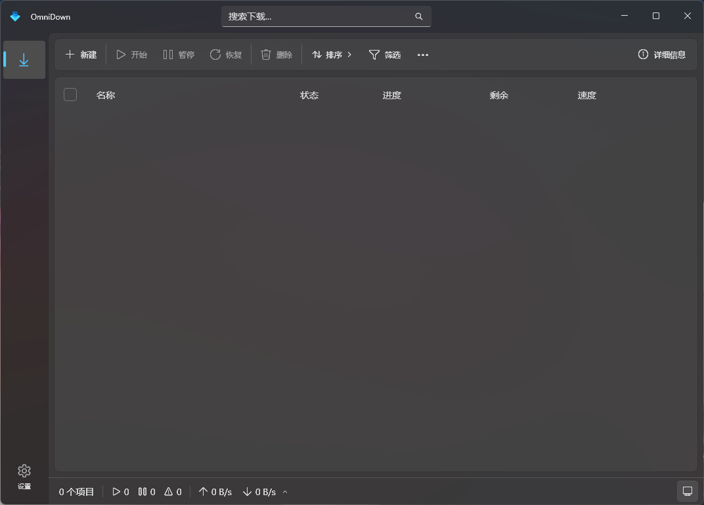
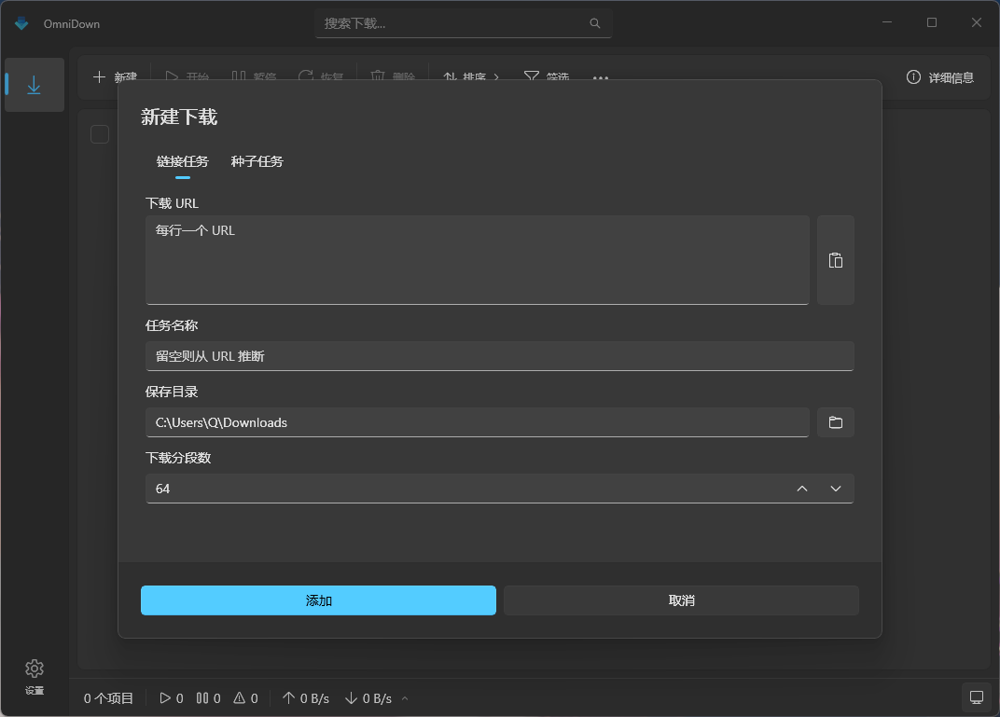
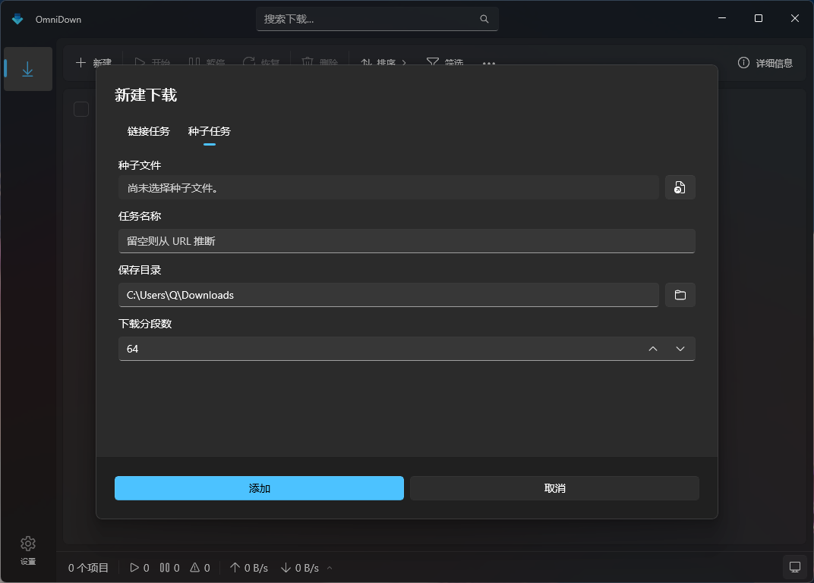
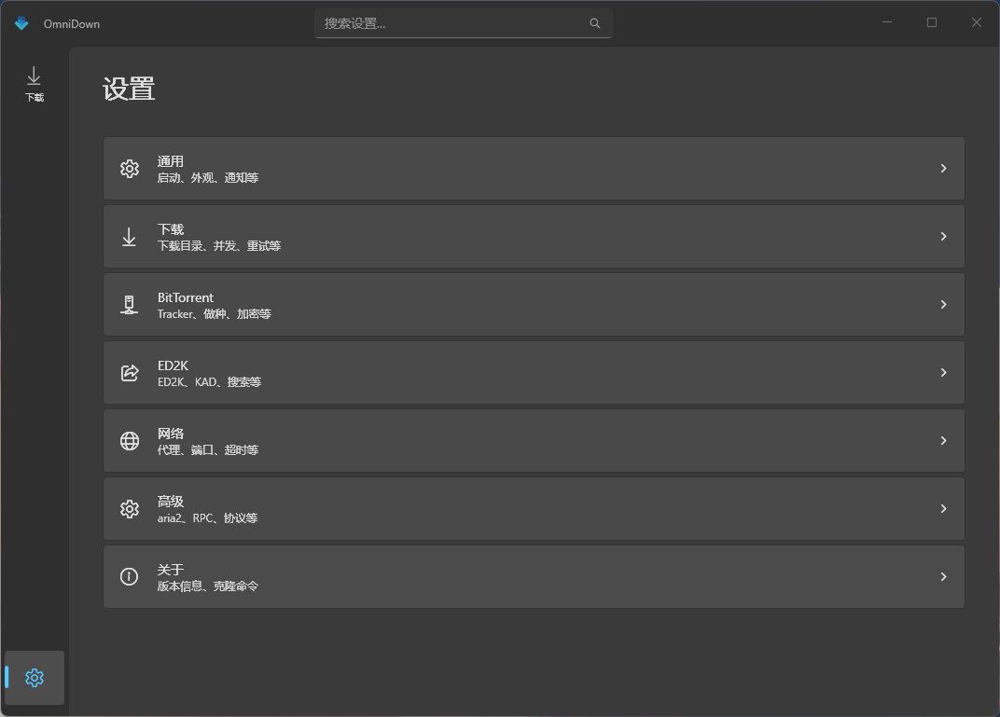

<div align="right">
  <a href="README.md">English</a> | <a href="README.zh-CN.md">简体中文</a>
</div>

# OmniDown

**A native WinUI 3 download manager for Windows.**

**Engine compatibility reference versions:** [aria2 1.37.0](https://github.com/aria2/aria2/releases/tag/release-1.37.0) · [aria2-next 2.5.6](https://github.com/AnInsomniacy/aria2-next/releases/tag/v2.5.6)

> [!NOTE]
> These are documented compatibility reference versions, not hard-coded version requirements or an exhaustive test matrix. Newer aria2-next releases are available, but full compatibility with them has not been verified for OmniDown.

OmniDown is a native Windows desktop application built with Windows App SDK, WinUI 3, C#, and XAML. It uses local JSON-RPC to control an aria2 or aria2-next download engine. The UI is native—not an Electron or WebView wrapper.

> [!WARNING]
> This project is still in an early stage of development. The interface and configuration formats may change. There is no stable release at present; avoid relying on it for important downloads without backups.

> [!NOTE]
> **Community maintenance welcome.** OmniDown is open source under the MIT License. The original author has limited time for ongoing maintenance and cannot guarantee regular updates or prompt reviews of issues and pull requests. Forks, improvements, and community contributions are welcome.

## Native WinUI 3

OmniDown uses WinUI 3 controls and Windows App SDK APIs directly for its desktop interface. It follows Windows Fluent Design and supports light, dark, and system themes. System notifications, taskbar progress, tray operation, protocol associations, and Windows widgets also integrate with native Windows capabilities instead of a cross-platform web UI runtime.

## Screenshots

### Home



### Add a download

| Regular download | Torrent download |
| --- | --- |
|  |  |

### Settings



## Features

- Manage HTTP, HTTPS, FTP, SFTP, magnet link, and `.torrent` download tasks
- Add, pause, resume, remove, filter, sort, and search downloads
- View progress, upload/download speeds, estimated time remaining, and task details
- Configure global and per-task speed limits, concurrency, connections, and retry behavior
- Configure BitTorrent trackers, seeding, encryption, proxies, and listening ports
- Resume interrupted downloads, restore sessions, and clear task history
- Use system notifications, taskbar progress, tray operation, and sleep prevention during downloads
- Switch between light, dark, and system themes
- Optionally enable clipboard link detection, protocol associations, a local browser extension API, and Windows widgets
- Select official aria2, aria2-next, or a custom compatible executable

## System requirements

- Windows 10 version 1809 (build 17763) or later
- An x86, x64, or ARM64 device
- An aria2-compatible download engine; see below

## Download engines

OmniDown provides the download manager UI; transfers are handled by a separate aria2-compatible process. Available options:

- [aria2](https://github.com/aria2/aria2): a mature engine supporting HTTP(S), FTP, SFTP, BitTorrent, and Metalink
- [aria2-next](https://github.com/AnInsomniacy/aria2-next): an aria2 JSON-RPC-compatible fork and the default engine type in OmniDown
- Custom engine: a user-supplied executable compatible with aria2 JSON-RPC

The compatibility reference versions are listed at the top of this README. Selecting an engine type does not lock it to that version.

**Download engines are not bundled with OmniDown releases.** Download a Windows executable for your architecture, then go to `Settings → Advanced → aria2 engine` in OmniDown. Select the engine type and import `aria2c.exe` or the appropriate aria2-next Windows executable. OmniDown copies the selected file into the MSIX-managed `%LOCALAPPDATA%\Packages\<package-family-name>\LocalState\engines\aria2\win-<architecture>` directory, so it no longer depends on the original download location. The imported engine is removed when the application is normally uninstalled. You may also make a compatible executable available through `PATH`.

OmniDown connects only to the RPC service it starts itself on `127.0.0.1`. You can change the RPC port and secret in advanced settings.

### Engine setup for development

Engine executables are not checked into Git. For local development, place an executable under `OmniDown/Engines/aria2/win-<architecture>`. Debug builds copy it to the output directory; Release builds and published packages always exclude these binaries. This allows convenient local debugging without accidentally distributing the engine.

OmniDown can check for and install updates to an imported aria2-next engine, but it does not automatically perform the initial engine download. App settings, task cache, and sessions are stored in `%LOCALAPPDATA%\OmniDown`, independently of build output directories. Imported engines live in MSIX `LocalState` and persist across F5/rebuilds under the same package identity, but are removed on normal uninstall. On first launch after an upgrade, engines from the older `%LOCALAPPDATA%\OmniDown\engines` location are migrated into `LocalState`, and the old copies are removed after a successful migration.

## Build from source

### Prerequisites

- Visual Studio 2022 with the relevant **Desktop development with C++** and **Universal Windows Platform development** components
- .NET 8 SDK
- Windows 10/11 SDK

### Build

Clone the repository:

```powershell
git clone https://github.com/JordanQD/OmniDown.git
cd OmniDown
```

Restore dependencies and build the solution (x64 example):

```powershell
dotnet restore OmniDown.slnx
dotnet build OmniDown.slnx -p:Platform=x64
```

Alternatively, open `OmniDown.slnx` in Visual Studio, choose your target architecture, and run or package the project.

## Project structure

```text
OmniDown/
├─ Controls/        Reusable WinUI controls
├─ Dialogs/         Dialogs, including Add Download
├─ Engines/aria2/   Engine configs and optional local Debug binaries (not committed)
├─ Models/          Download-task and settings models
├─ Pages/           Download and settings pages
├─ Services/        aria2 RPC, engine, notification, tray, and widget services
├─ Strings/         Simplified Chinese and English resources
└─ ViewModels/      Page and control view models
```

## Contributing

Contributions, forks, and continued development by the community are welcome. Please use [Issues](https://github.com/JordanQD/OmniDown/issues) for bug reports and suggestions or submit a pull request for a focused change. Before submitting code, make sure the solution builds successfully and keep each change scoped to a clear purpose.

The project is provided as-is. The original author may not be available to respond promptly or provide ongoing support.

## License

OmniDown's own source code is licensed under the permissive [MIT License](LICENSE). You may use, copy, modify, and redistribute it provided the original copyright and license notices are retained.

The MIT License applies to OmniDown's code only. Neither aria2 nor aria2-next is included in the distribution. Download engines imported by users are separate third-party programs licensed under GNU GPL v2; follow their respective licenses and any applicable third-party dependency terms when downloading, using, or redistributing them.

## Dependencies and acknowledgments

OmniDown's implementation, UI design, and feature planning draw on or use the following open-source projects:

- [files-community/Files](https://github.com/files-community/Files)
- [AnInsomniacy/motrix-next](https://github.com/AnInsomniacy/motrix-next)
- [aria2/aria2](https://github.com/aria2/aria2)
- [AnInsomniacy/aria2-next](https://github.com/AnInsomniacy/aria2-next)
- [Devolutions/UniGetUI](https://github.com/Devolutions/UniGetUI)
- [microsoft/WinUI-Gallery](https://github.com/microsoft/WinUI-Gallery)
- [microsoft/WindowsAppSDK](https://github.com/microsoft/WindowsAppSDK)
- [microsoft/microsoft-ui-xaml](https://github.com/microsoft/microsoft-ui-xaml)
- [CommunityToolkit/Windows](https://github.com/CommunityToolkit/Windows)

## Tracker sources

Built-in tracker source options use these public projects:

- [XIU2/TrackersListCollection](https://github.com/XIU2/TrackersListCollection)
- [ngosang/trackerslist](https://github.com/ngosang/trackerslist)
